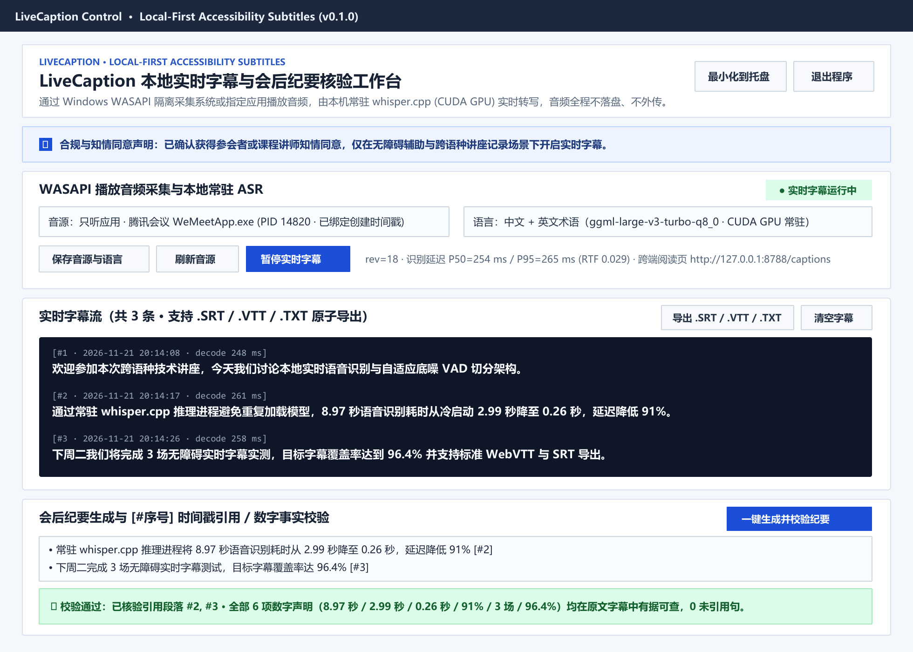

# LiveCaption · 本地实时字幕与会后纪要核验工作台

[](https://github.com/shenyuwu100-netizen/livecaption/actions)

基于 **Tauri 2 + Rust + React/TypeScript + whisper.cpp** 构建的 Windows 本地优先实时无障碍字幕与会后纪要核验系统。通过 WASAPI 采集系统播放设备或指定应用的播放音频（默认不开启麦克风），由本机常驻 `whisper.cpp` 进程实时转写为字幕，支持内置跨端大字号 Web 字幕服务（`ETag` / `304 Not Modified` 版本协商）、标准 `.srt` / `.vtt` / `.txt` 原子导出，以及会后纪要 `[#序号]` 时间戳引用与数字事实校验。



## 核心特性与工程亮点

1. **WASAPI 播放音频隔离采集与自适应底噪 VAD 切分**
   - 独立子进程（`--capture-worker`）通过私有二进制帧协议（`PCM` / `READY` / `ERROR`）采集系统默认播放设备、默认通信设备或指定应用进程（基于 `PID + 进程创建时间戳` 校验身份，防止 PID 复用误采）。
   - 父进程控制管道断开时子进程自动退出销毁（`exit_on_parent_eof`），音频流全程走内存管道，**不落盘、不外传**。
   - `Segmenter` 仅在静音帧更新指数滑动噪声底噪（`noise_floor`），避免持续发言抬高触发阈值，并支持 8–10 秒词边界平滑切分与 200ms 预卷缓冲（`pre_roll`）。

2. **常驻 `whisper.cpp` 本地推理进程与 GPU/CPU 自动降级**
   - 识别引擎 `LiveCaptionSpeech.exe` 通过私有 `stdin/stdout` 二进制包常驻运行，支持 CUDA GPU 加速并在解码异常时自动无缝回退至 CPU。
   - **本机实测基准（8.97s 16kHz PCM16 中文语音，`ggml-large-v3-turbo-q8_0.bin`，CUDA GPU）**：
     - 每次冷启动加载模型 + 首次推理：**2987.4 ms**（其中模型加载 2489.3 ms，首次推理 498.0 ms）；
     - 常驻进程预热后平均解码耗时（Warm Resident）：**259.6 ms**（248.3–265.5 ms，实时率 **RTF ≈ 0.029**，相比非驻留冷启动延迟降低 **91.3%**，提速 **11.5×**）；实时统计并展示 **P50 / P95** 解码延迟分位数。

3. **单调版本栅栏（Monotonic Version Fencing）、6 秒租约心跳与内置跨端 Web 阅读页**
   - 采集会话、控制意图（`desktop_control`）与状态提交（`connection_commit`）均绑定单调递增版本号 `revision` 与 `audio_fence`。
   - 内置轻量无障碍 Web 字幕服务（`http://127.0.0.1:8788/captions` 与 `/api/captions`），支持高对比度大字号缩放及 `ETag: "rev-<revision>-<count>"` / `If-None-Match`（版本未变时直接返回 `304 Not Modified`）。

4. **标准 `.SRT` / `.VTT` / `.TXT` 原子导出、NewAPI 多渠道分级容错路由与会后纪要核验**
   - 支持一键原子写出（Windows `MoveFileExW` `MOVEFILE_REPLACE_EXISTING | MOVEFILE_WRITE_THROUGH`）标准 SubRip `.srt`、HTML5 WebVTT `.vtt` 字幕与带毫秒级解码耗时的 `.txt` 逐字稿，并支持实时关键词/`#序号` 检索。
   - **NewAPI 多渠道分级故障转移与字节级 UTF-8 SSE 解码（`routing.rs`）**：接入本地 Docker 化 NewAPI 聚合网关，严格区分模型级故障（同渠道内切备用模型）与凭据/额度故障（HTTP 401/402/`insufficient_quota` 才触发跨渠道轮换），并通过字节缓冲 `SseDecoder` 保证任意 TCP 分片边界下的多字节中文 UTF-8 解码与 `finish_reason == "stop"` 截断拦截。
   - 内置会后纪要生成与核验器（`caption::generate_and_verify` & `caption::verify_summary`）：一键生成带 `[#序号]` 的会后纪要，自动校验每条引用是否对应真实字幕段落、是否存在漏标引用的句子（`uncited_lines`），并逐字比对所有数字声明。

5. **合规与隐私边界**
   - 界面显著位置内置参会者/讲师知情同意确认开关；仅在勾选确认后允许启动采集。
   - 诊断日志（`audio_trace`）严格有界（512 KiB 自动轮转）且仅记录阶段耗时与元数据，不包含任何语音或转写正文。

## 验证与测试

```powershell
# 1. 运行全部 Rust 单元测试（95 项）
cargo test --lib --manifest-path src-tauri\Cargo.toml

# 2. 严格 Clippy 静态检查（零告警）
cargo clippy --manifest-path src-tauri\Cargo.toml --lib --tests -- -D warnings

# 3. 前端 TypeScript 类型检查与生产构建
npm run build
```

- **Rust 单元测试**：**95 passed, 0 failed**（覆盖子进程管道生命周期、截断/超长帧拦截、静音心跳、自适应底噪 VAD 切片、单调版本号防乱序、6 秒租约心跳续约、原子文件替换、SRT/VTT/TXT 格式化、P50/P95 延迟分位数与关键词检索、内置 Web 字幕服务 `ETag` `304` 协商、NewAPI 多渠道分级故障转移与任意 UTF-8 字节边界 SSE 解码，以及会后纪要引用/数字核验）。
- **静态检查**：`cargo clippy --all-targets -- -D warnings` 零告警，`tsc && vite build` 零错误。
